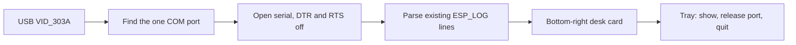

# Desk studio boilerplate

The corner is a host-only visit, in the spirit of Weyrdlets desktop mode: while the cable is in, the pet can later appear in a small always-on-top card. The glass keeps the current habitat room. This is not a firmware room, not a door, and not the cortex. The v1 map in [architecture.md](architecture.md) stays Nest, Play, Hall, Yard.

This pass draws no pet and adds no snapshot protocol. The window is text. It owns the COM port, so it cannot run beside `flash.bat --watch`.

## Document

Add [docs/studio.md](docs/studio.md):

- Desk is a host visit. Firmware does not know the window exists, same rule as `board-sim`.
- Play still works with the app closed. Unplug hides the visit. The lizard brain does not move onto the PC.
- Later: the pet drawn in that corner, debug flags (hitbox wireframe and the rest), and the UDP cortex guest inside this same .NET process. Not this pass.
- Later: start the tray app at login so the card appears on plug-in. This pass launches only when you run it.
- Port rule: the card holds the COM port. Release it from the tray before `flash.bat`. Opening the port must not reboot the chip.

Point at that doc from [architecture.md](architecture.md) next to the existing “USB = studio” line, and add one open-question line: the Desk visit is host-only and is not a fifth room. Do not edit the map.

In [README.md](README.md), add `studio/` as a third piece beside `firmware/` and `board-sim/`, and document `studio.bat`.

## App

.NET 10 SDK is already installed (`10.0.401`). New Avalonia 11 desktop app in [studio/](studio/), hand-written and small, target `net10.0`.

- Borderless, not in the taskbar, always on top, fixed size, parked on the bottom-right of the primary work area (above the taskbar).
- Close hides to the tray. Tray menu: Show, Release port, Quit.
- Find the port the same way [flash.bat](flash.bat) does: one `VID_303A` device whose name contains `(COMx)`. Zero ports: “no board”. More than one: say so and do not open.
- Open with `System.IO.Ports`, DTR and RTS left off, no esptool reset. If the port is busy, say it is in use.
- Read lines on a background thread. Show connected, the COM name, and the numbers the firmware already prints in [firmware/main/esp32/platform.c](firmware/main/esp32/platform.c) and [firmware/main/main.c](firmware/main/main.c): `free internal`, the latest `ship`, and `gap mean`. Until a line has arrived, that stat stays blank. Heap is only logged at boot, so it stays blank until the next boot line. Also show the last few log lines.
- When the device drops, close the handle and return to “no board”.
- No firmware edits. A periodic stats log would land inside the frame-gap measurement.

[studio.bat](studio.bat) runs `dotnet run --project studio`. Ignore `studio/bin/` and `studio/obj/` in [.gitignore](.gitignore).
